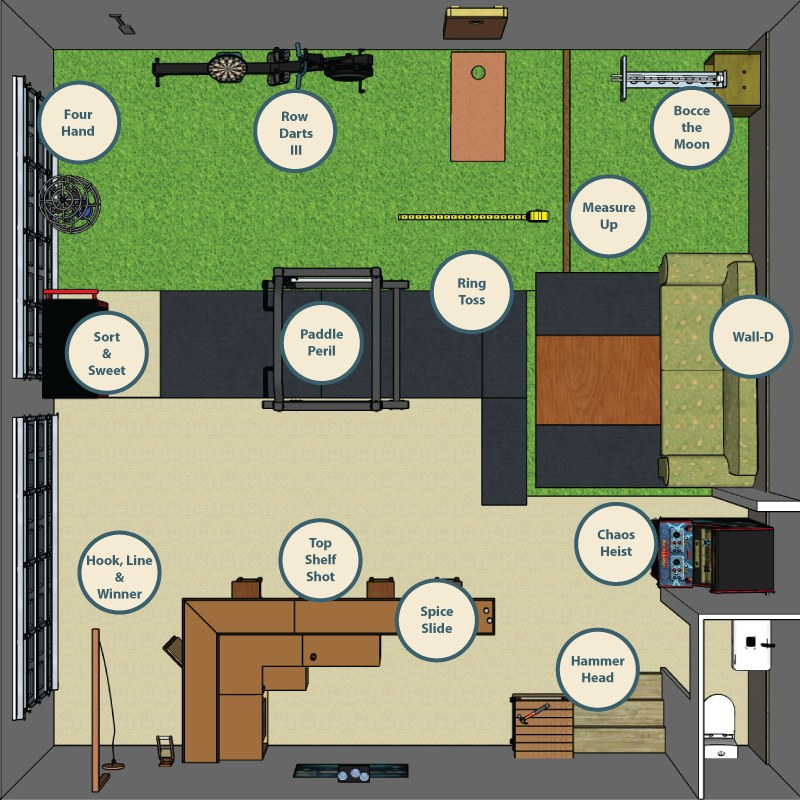
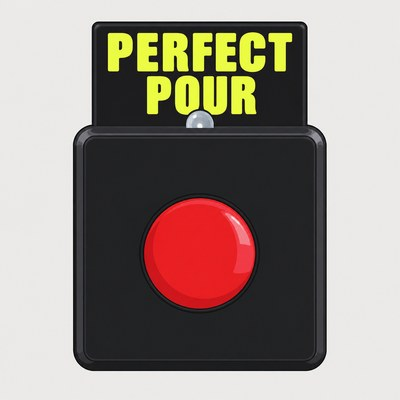

## The course

The locations depicted above are the approximate competition zones, NOT the locations of the buttons. Additional lines, scoring zones, and restriction zones are not indicated.

## The run

You have 5 minutes to complete as many of the 13 events as you can. Most points wins.

Competitors will start in the center of the room, inside the squat rack. After a countdown, you may start any event by pressing its button. Events can be done in any order. You may start an event and decide not to finish it, and start another event. Any number of events can be active at the same time, and you may always return to finish an event. 

When you have completed an event, you must press the button again. This records your time/score. Pressing the button to finish the event is considered part of the event, it is up to you to remember. No time/points will be added back for late finish presses, regardless of when the event was completed.

In most cases it will be obvious when you have completed the objective, and may proceed without acknowledgement from the judge, however, the player should be aware of possible infractions requiring correction or restart as indicated by the judge before pressing the finish button. Early finish button presses will be assessed an additional penalty after the run.

Your run ends automatically when your 5 minutes elapses. Button presses after the 5 minutes will have no effect.

## Buttons

Each station* has a button labeled with the sign for that event. When the run begins, all buttons lights will flash for the countdown, and then go solid red to indicate they have not yet been completed.

1. Press any button to start that event. The light blinks yellow while it's active but not completed.
2. Complete the objective.
3. Press the button again when you finish. The light turns green to indicated it is completed.

*The Wall-D event button will only be pressed to **start** the event, any additional presses will have no effect. The finish is logged automatically.

*The Chaos Heist event **does not have a button**, instead, collecting and placing the emeralds will count as the start button, and the finish will be logged automatically.

## Scoring

Events are worth a variable amount of points estimated for difficulty, and listed here in this guide. Each event is assigned a grace period in seconds, during which you can complete the event for the maximum number of points. After the grace period, points are subtracted for each second the event remains unfinished. 

You can never score fewer than half the maximum amount of points for an event, regardless of how long it takes to complete the event.

If you begin an event, but then decide to switch to another event, your clock does not stop for the purposes of subtracting points. Thus it is rarely, if ever, advantageous to simply start an event and then instantly run to another event.

The points system is not actually complex, you will always score the most points by completing each event as quickly as possible. If you are truly stuck on an event, once you hit the half point mark, there is essentially no penalty for moving on and trying again later.

All listed points, grace periods, and subsequent points lost are subject to change.

## Bonus round

If you complete **all** the events with time remaining on the clock, the Sonic Speed Dash bonus round starts automatically. See the bonus round event for additional information.

## Playoffs

Top scoring competitors may compete in an additional playoff round to determine a champion, subject solely to time available and judges discretion.

## General guidelines and other information

- **ALL GUIDELINES ARE SUBJECT TO CHANGE UP TO AND INCLUDING THE DAY OF THE EVENT AND MAY NOT BE UPDATED HERE**
- Please help clear/reset the course after each competitor.
- You may spectate from anywhere inside or out of the garage, as long as you stay clear of the competitors/judge.
- Assistants may advise on strategy but **may not touch or influence any event**.
- The head judge has sole discretion on all matters. This is a Gametatorship.
- There's no crying in Garage Games.
- Do not break Sonic.
